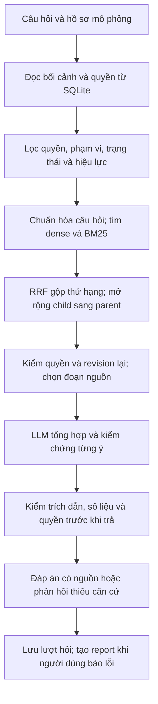

# DEMO RAG

Demo hỏi đáp tri thức nội bộ có phân quyền theo tổ chức, quản lý phiên bản và trích dẫn nguồn.

**Demo online:** [demo-rag-tavu.onrender.com](https://demo-rag-tavu.onrender.com/) — mở bằng trình duyệt, không cần cài ứng dụng. Bản Render Free có thể cần chờ khởi động sau thời gian không truy cập; dữ liệu thay đổi trên demo không được lưu bền vững.

## Deploy demo miễn phí, không cần giữ máy cá nhân bật

[Tạo web service trên Render từ repo này](https://render.com/deploy?repo=https://github.com/dat28062006/DEMO-RAG).

Repo có `Dockerfile` và `render.yaml` dùng **Render Free**, không tạo database trả phí hoặc persistent disk. Hosting tự build Docker từ GitHub; máy cá nhân **không cần cài/chạy Docker Desktop**.

1. Đăng ký hoặc đăng nhập [Render](https://dashboard.render.com/) bằng tài khoản của bạn.
2. Mở link deploy phía trên, chọn repo `dat28062006/DEMO-RAG` và tạo Blueprint. Nếu dùng **New → Web Service → Public Git Repository**, nhập URL repo, chọn **Docker**, nhánh `main`, vùng Singapore và **Free**. Dockerfile ở `./Dockerfile`; không điền build/start command Python riêng.
3. Trong **Environment**, thêm `GROQ_API_KEY` bằng ô secret của Render, và `GROQ_MODEL=openai/gpt-oss-120b`. Không đưa key vào Git, Dockerfile hoặc README. Nếu chưa cấu hình secret, có thể nhập qua **Cấu hình LLM** trên web sau khi deploy; key nhập trên web chỉ có tác dụng đến lần restart tiếp theo.
4. Đặt **Health Check Path** thành `/api/health`. Giữ port do Render cấp qua biến `PORT`; ứng dụng tự nghe tại `0.0.0.0:$PORT`.
5. Chọn **Deploy** và chờ log có `Cloud template ready` ở bước build, sau đó `DEMO RAG listening` ở bước chạy. Render cấp link HTTPS dạng `https://<ten-service>.onrender.com`. Gửi **link này** cho người thử; không gửi link dashboard.
6. Kiểm tra `/api/health`, rồi mở web, chọn An/Bình và hỏi `Quy định hỗ trợ tiền ăn của tôi là gì?`. Import PDF/Word trong **Quản lý & duyệt tài liệu**, duyệt và công bố trước khi hỏi nội dung của tài liệu vừa nhập.

### Bản cloud hoạt động thế nào?

- Khi build, tải model **paraphrase-multilingual-MiniLM-L12-v2 ONNX quantized**, khóa revision và kiểm tra checksum; tạo chỉ mục cho các tài liệu giả lập trong repo. Không tải Qwen hoặc Ollama lên hosting nhỏ.
- Khi chạy, sao chép database mẫu đã lập chỉ mục sang `runtime/cloud.sqlite3` **nếu chưa có**. Không chép database, file đã import, lịch sử hỏi đáp hoặc key từ máy phát triển.
- Chunking semantic parent–child, BM25 + dense + RRF, kiểm quyền, hiệu lực, phiên bản và trích dẫn dùng cùng pipeline với bản local. Embedding cloud là 384 chiều; profile local Qwen vẫn giữ 1024 chiều, các chỉ mục không dùng lẫn nhau.
- Secret `GROQ_API_KEY` được đọc khi khởi động vào bộ nhớ server để mọi phiên demo dùng chung; ứng dụng không lưu giá trị key vào SQLite và không trả key về trình duyệt. Render vẫn lưu secret trong cấu hình hosting để cấp lại sau restart.
- Tự nhận HTTPS origin từ `RENDER_EXTERNAL_URL`; nếu dùng tên miền riêng, đặt `PUBLIC_ORIGIN=https://ten-mien-cua-ban`. Chỉ thêm chính xác origin cần dùng.
- Bản cloud xử lý tối đa một yêu cầu ghi/import/hỏi đáp cùng lúc để hạn chế RAM. Nếu đang bận, trả thông báo thử lại.

**Giới hạn Free:** Render có thể đưa service về chế độ ngủ sau 15 phút không truy cập, nên lần mở lại có thể phải chờ khởi động. Filesystem không bền vững: dữ liệu import, sửa quyền, hội thoại và báo lỗi có thể mất khi restart/redeploy/service ngủ; demo trở về dữ liệu mẫu trong image. Đừng dùng bản này làm kho lưu trữ tài liệu. Xem [giới hạn Render Free](https://render.com/docs/free).

Demo hiện dùng **hồ sơ mô phỏng có thể đổi trên giao diện**, chưa có đăng nhập người dùng thật. Chỉ dùng dữ liệu giả lập hoặc tài liệu bạn chấp nhận chia sẻ với người có link demo.

### Chạy profile Docker trên máy có Docker hoạt động

```powershell
docker build -t demo-rag .
# Tạo biến GROQ_API_KEY trong terminal bằng cách nhập bí mật trực tiếp.
# Lệnh dưới truyền giá trị biến vào container, không ghi key vào image.
docker run --rm -p 8765:10000 -e GROQ_API_KEY demo-rag
```

Mở `http://127.0.0.1:8765/`. Container không có volume nên dữ liệu mất khi xóa container. Các lệnh cài/chạy Python local dưới đây vẫn dùng profile Qwen như trước.

## Hướng dẫn chạy ứng dụng

Các lệnh dưới đây dùng **Windows PowerShell**, chạy tại thư mục gốc của repo. Có thể mở terminal trong VS Code hoặc PowerShell thông thường.

### 1. Chuẩn bị

- Git để tải source.
- Python **3.10 trở lên**, có `pip`.
- Ollama nếu muốn chạy embedding và tìm kiếm hybrid.
- API key Groq hoặc OpenAI nếu dùng API để sinh đáp án; nhập trên web sau khi chạy ứng dụng.

Kiểm tra Git và Python:

```powershell
git --version
python --version
python -m pip --version
```

Nếu máy dùng Python Launcher, có thể thay `python` bằng `py -3` ở bước tạo môi trường. Cài Ollama từ [ollama.com](https://ollama.com/) trước khi thực hiện bước 4.

### 2. Clone repo và cài dependency

```powershell
git clone https://github.com/dat28062006/DEMO-RAG.git
cd DEMO-RAG
python -m venv .venv
.\.venv\Scripts\python.exe -m pip install -r requirements.txt
```

Các lệnh sau gọi trực tiếp Python trong `.venv`, không cần kích hoạt môi trường bằng `Activate.ps1`.

### 3. Mở web lần đầu

```powershell
.\.venv\Scripts\python.exe server.py --port 8765
```

Khi terminal hiện địa chỉ ứng dụng, mở **http://127.0.0.1:8765/**. Giữ terminal này chạy trong lúc sử dụng web. Có thể mở **http://127.0.0.1:8765/api/health** để kiểm tra server trả JSON.

Ở bước này chưa cấu hình model thì ứng dụng dùng chế độ trích xuất theo nguồn. Để có semantic/hybrid RAG và LLM, tiếp tục bước 4 và 5. Dừng server bằng **Ctrl+C** trước khi thiết lập tiếp.

### 4. Thiết lập embedding và chỉ mục RAG

Chạy trong **cùng một cửa sổ PowerShell** để các lệnh tải model dùng đúng cổng và thư mục model:

```powershell
.\scripts\setup\start_models.ps1
$demoOllama = Join-Path $env:LOCALAPPDATA 'Programs\Ollama\ollama.exe'
& $demoOllama pull qwen3-embedding:0.6b
& $demoOllama pull qwen3.5:4b
.\.venv\Scripts\python.exe scripts/setup/setup_rag.py
.\.venv\Scripts\python.exe scripts/setup/setup_api.py
```

- `start_models.ps1` dùng Ollama cài tại `%LOCALAPPDATA%\Programs\Ollama\ollama.exe`, phục vụ model ở **127.0.0.1:11435**, lưu model trong `runtime/models/ollama/`.
- `qwen3-embedding:0.6b` tạo vector cho tìm kiếm. `qwen3.5:4b` phục vụ sinh đáp án local.
- Script `setup_rag.py` hiện kiểm **cả hai model**, chốt digest và lập chỉ mục. Vì vậy cần tải cả hai theo các lệnh trên, kể cả khi sau đó chuyển phần sinh đáp án sang API.
- Chờ lệnh tải và lập chỉ mục hoàn tất. Thiết lập thành công sẽ in `READY` cùng số tài liệu. Script có tạo backup trước khi thay cấu hình.
- `setup_api.py` thiết lập quyền cấu hình API cho kho dữ liệu; không tự nhập hoặc lưu API key.

Sau khi hoàn tất, chạy lại server:

```powershell
.\.venv\Scripts\python.exe server.py --port 8765
```

### 5. Chọn LLM trên web

Để dùng **Groq hoặc OpenAI API**:

1. Mở web, chọn hồ sơ **Dũng** hoặc **Hà** ở góc trên bên phải.
2. Chọn **Cấu hình LLM** ở thanh bên.
3. Chọn nhà cung cấp, kiểm tra model, nhập API key trực tiếp vào ô bảo mật.
4. Xác nhận cho phép gửi câu hỏi và các đoạn nguồn được cấp quyền tới nhà cung cấp.
5. Bấm **Kiểm tra kết nối & dùng Groq/OpenAI**, chờ thông báo thành công.
6. Chuyển sang hồ sơ muốn thử rồi mở **Hỏi đáp**.

Embedding vẫn chạy local khi dùng API. Key chỉ giữ trong **RAM server**, không đưa vào source, database hoặc report; khởi động lại server cần nhập lại. API có thể giới hạn quota hoặc tính phí. Nếu API lỗi, hệ thống không tự chuyển sang model local.

Để dùng **model local**, chọn **Dùng lại model local** trong Cấu hình LLM. Model và Ollama cần đang sẵn sàng; chạy trên CPU có thể chậm.

### 6. Thử trên giao diện

1. Chọn **An** hoặc **Bình** trong **Hồ sơ mô phỏng**.
2. Đặt **Ngày áp dụng** dưới ô chat, nhập câu hỏi rồi bấm **↑**.
3. Bấm thẻ nguồn dưới câu trả lời để mở câu được highlight. **Mở toàn bộ tài liệu** vẫn giữ highlight và cuộn tới vị trí đó.
4. Chọn hồ sơ quản lý để import, duyệt, công bố hoặc tạo phiên bản mới.

Câu hỏi mẫu:

```text
Tiền ăn tối của tôi là bao nhiêu?
Tiền ăn tối theo quy định tập đoàn là bao nhiêu?
Tôi được làm việc từ xa mấy ngày mỗi tuần?
```

Sau khi tự import, duyệt và công bố tài liệu chuyên môn, có thể hỏi nội dung của tài liệu đó. Repo không kèm những PDF/DOCX đã được nhập trên máy phát triển.

### 7. Chạy lại ở những lần sau

Không cần tạo lại `.venv`, cài lại dependency hoặc tải model mỗi lần mở ứng dụng:

```powershell
cd DEMO-RAG
.\scripts\setup\start_models.ps1
.\.venv\Scripts\python.exe server.py --port 8765
```

Nếu dùng API, nhập lại key trong **Cấu hình LLM** sau khi server khởi động. Bước chạy model cần thiết khi dùng embedding/local LLM. Bấm Ctrl+C tại terminal để dừng web.

### macOS/Linux

Tạo môi trường và cài dependency bằng Python của hệ điều hành:

```bash
git clone https://github.com/dat28062006/DEMO-RAG.git
cd DEMO-RAG
python3 -m venv .venv
.venv/bin/python -m pip install -r requirements.txt
```

Để cấu hình RAG, khởi chạy Ollama ở terminal riêng:

```bash
export OLLAMA_HOST=127.0.0.1:11435
export OLLAMA_MODELS="$PWD/runtime/models/ollama"
mkdir -p "$OLLAMA_MODELS"
ollama serve
```

Ở terminal thứ hai, trong thư mục repo:

```bash
export OLLAMA_HOST=127.0.0.1:11435
ollama pull qwen3-embedding:0.6b
ollama pull qwen3.5:4b
.venv/bin/python scripts/setup/setup_rag.py
.venv/bin/python scripts/setup/setup_api.py
.venv/bin/python server.py --port 8765
```

Giữ terminal Ollama và terminal web hoạt động. Các bước chọn provider và sử dụng giao diện giống Windows.

## Tính năng

### Hỏi đáp theo bối cảnh

- Dùng hồ sơ từ database: đơn vị, phòng ban, nhóm và vai trò; không lấy quyền do người hỏi tự khai trong câu chat.
- Tách **quyền được đọc tài liệu** khỏi **chính sách áp dụng cho bản thân**. Người quản lý đọc được nhiều công ty không đồng nghĩa hưởng chính sách của mọi công ty.
- Xét ngày áp dụng khi chọn chính sách và phiên bản.
- Hỗ trợ hỏi tiếp trong cùng hội thoại và hỏi lại khi thiếu bối cảnh có thể làm rõ. Khi nguồn không đủ, trả trạng thái chưa đủ căn cứ thay vì tự kết luận.
- Có nút **So sánh An / Bình** để xem cùng câu hỏi trong hai bối cảnh demo.

### Tra cứu và trích dẫn

- Kết hợp tìm theo từ khóa với vector ngữ nghĩa, trả nội dung từ đoạn nguồn liên quan.
- Hỗ trợ hỏi tiếng Việt trên tài liệu tiếng Anh trong phạm vi mô hình và thuật ngữ hiện có; không bảo đảm mọi cách diễn đạt đều tìm đúng.
- Câu trả lời sinh bằng LLM gắn trích dẫn tới câu nguồn, kèm phiên bản và vị trí khi xác định được.
- Viewer hiển thị văn bản trích xuất, highlight câu được viện dẫn; xem toàn bộ tài liệu vẫn giữ highlight. Có thể tải file gốc theo quyền hiện hành.

### Import PDF/DOCX

- Trích văn bản từ PDF có lớp text, hoặc phần thân và bảng trong DOCX; giữ bytes gốc và checksum để đối chiếu.
- Khai báo tên, chủ đề, công ty/phòng/chức danh áp dụng, ngày hiệu lực và quyền đọc.
- Chọn công ty, cả phòng hoặc từng nhân sự. Hồ sơ có quyền cấp tập đoàn có thể chọn **Tập đoàn / nhiều công ty** rồi tích đồng thời A/B.
- File mới là **bản chờ duyệt**, chưa trở thành nguồn trả lời ngay khi upload hoặc lập chỉ mục xong.
- Giới hạn hiện tại: **2 MB/file**, **50 trang PDF**, **58.000 ký tự văn bản trích xuất**. Không nhận `.doc` cũ, PDF có mật khẩu hoặc scan cần OCR.

### Duyệt và công bố

Luồng tài liệu cấp công ty:

```text
Import → Chờ giám đốc duyệt phạm vi người xem
       → Trưởng phòng xác nhận nhân sự trong phạm vi đó
       → Đã duyệt → Người có quyền công bố xuất bản
```

Giám đốc xác định danh sách tối đa. Trưởng phòng chỉ chọn người trong phòng mình và trong danh sách đã duyệt; không thêm người ngoài phạm vi hoặc duyệt thay phòng khác. Hoàn tất các phòng liên quan mới được công bố.

Chủ tịch có grant duyệt trực tiếp riêng cho trường hợp được giao, phải ghi lý do và lưu audit. Công bố vẫn là thao tác riêng; không bỏ qua kiểm tra trạng thái, hiệu lực hay chỉ mục. Tài liệu dùng chung cấp tập đoàn được xử lý bằng quyền tương ứng cấp tập đoàn.

### Phiên bản và hiệu lực

- Sửa nội dung tạo phiên bản mới; giữ nội dung cũ để đối chiếu, bản sửa cần duyệt/công bố lại.
- Quan hệ `supersedes` biểu diễn bản thay thế; `overrides` biểu diễn ngoại lệ đối với nguồn nền.
- Tách các nhóm **Còn hiệu lực**, **Hết hiệu lực / bản cũ**, **Chờ duyệt / chưa đến hiệu lực**.
- Không chọn nguồn chỉ vì có số phiên bản lớn hơn hoặc được upload gần nhất.
- Nguồn thu hồi, chưa công bố hoặc hết hiệu lực không được dùng làm căn cứ hiện hành. Việc bản thay thế không dùng được không tự hồi sinh bản tiền nhiệm đã thay thế.
- Giám đốc đổi ACL đưa tài liệu về chuỗi duyệt; quản trị tập đoàn có quyền cập nhật trực tiếp được ghi audit. Danh sách cá nhân đã duyệt không tự thêm nhân sự mới.

### Báo lỗi và truy vết

- **Báo lỗi** dưới phản hồi cho phép chọn loại lỗi và mô tả kỳ vọng.
- Report gắn với request đã lưu, gồm hội thoại và context xử lý; lượt LLM có prompt, evidence, output và revision cấu hình/model phục vụ tái hiện.
- **Report & cải thiện** cho người có quyền theo dõi trạng thái mới tiếp nhận, đang xác minh, đã xử lý.
- Người xem report còn phải có quyền hiện hành với các nguồn trong context. API key không được đưa vào report.

## Cách hệ thống hoạt động

### Luồng tổng thể



Sơ đồ mô tả nhánh RAG có LLM. Một số câu hỏi chính sách dùng nhánh trích xuất/kiểm quy tắc; tìm file theo tên và chế độ chưa cấu hình model cũng có đường xử lý riêng. Không phải mọi phản hồi đều gọi LLM.

### 1. Xác định quyền và nguồn hợp lệ

SQLite là nguồn chuẩn cho tổ chức, hồ sơ, quyền, metadata và quan hệ phiên bản. Backend lấy lại dữ liệu này khi xử lý yêu cầu. Model không được quyết định hoặc tự mở rộng quyền.

Các lớp kiểm tra:

| Lớp             | Ý nghĩa                                                                             |
| --------------- | ----------------------------------------------------------------------------------- |
| Quyền hành động | Ai được đọc, tạo bản sửa, duyệt, công bố, thu hồi, chỉnh ACL hoặc xem report        |
| Phạm vi tổ chức | Quyền ở tập đoàn/công ty/phòng và có được mở xuống đơn vị con hay không             |
| ACL tài liệu    | Danh sách cho phép và từ chối theo công ty, phòng, nhóm, cá nhân; deny được ưu tiên |
| Phạm vi áp dụng | Chính sách có áp dụng cho công ty/phòng/chức danh của người hỏi không               |
| Vòng đời        | Đã duyệt, công bố, đúng ngày hiệu lực, chưa thu hồi hoặc bị thay thế                |

Nhân viên A/B thông thường không đọc chéo tài liệu riêng của công ty. Quyền đọc tổ chức không tự mở hồ sơ HR cá nhân; quyền quản trị đặc biệt phải có grant riêng. Tên chức danh hiển thị không tự tạo quyền.

### 2. Chunking và embedding

1. Trích văn bản, giữ checksum và vị trí trong nguồn.
2. Chia thành **child** gần với đơn vị câu, lưu offset để trích dẫn chính xác.
3. Gom các câu liền kề cùng khối thành **parent** dựa trên độ gần embedding và dấu hiệu bổ trợ, có giới hạn chiều dài.
4. Dùng Qwen3 Embedding qua Ollama tạo vector **1024 chiều** cho child.
5. Lưu parent, child, vector và manifest gắn checksum nguồn, digest model, revision cấu hình.

Semantic parent-child là **cách chia đoạn và giữ bối cảnh**; embedding là bước biến nội dung thành vector. Việc gom parent hiện là heuristic của MVP, chưa bảo đảm phân đoạn hoàn hảo với mọi bố cục.

### 3. Hybrid retrieval

- Chuẩn hóa cách viết và một số lỗi gõ; mở rộng một số thuật ngữ Việt–Anh khi có căn cứ trong nguồn được phép.
- **Dense search** dùng cosine similarity giữa embedding câu hỏi và child.
- **BM25** tìm độ khớp từ khóa; BM25 không tự dịch câu hỏi.
- **RRF** gộp hai danh sách thứ hạng để chọn đoạn ứng viên.
- Từ child tìm được, mở parent và các phần liên quan có giới hạn để giữ điều kiện, ý bổ trợ hoặc cấu trúc mục.

Tìm kiếm chạy trên tập nguồn đã qua lọc quyền/hiệu lực. Thay đổi quyền không cần embedding lại; quyền được kiểm theo dữ liệu hiện hành. Thay đổi nội dung hoặc cấu hình index cần lập lại chỉ mục phù hợp.

### 4. Sinh đáp án và kiểm chứng

Nhánh LLM dựng evidence theo câu và yêu cầu mỗi ý có tham chiếu nguồn. Sau khi sinh, hệ thống kiểm cấu trúc, câu trích dẫn, số liệu, độ bao phủ các phần cần thiết và mức hỗ trợ của nguồn. Quyền/checksum/revision được kiểm lại trước khi gửi model và trước khi trả kết quả.

Khi thiếu dữ liệu hoặc kiểm chứng không đạt, có thể hỏi làm rõ hoặc từ chối kết luận. Cơ chế này giảm rủi ro trả lời sai, không bảo đảm LLM luôn suy luận đúng.

Viewer nguồn dùng quote và offset đã được server xác nhận từ lượt hỏi, không tin vị trí tùy ý do client khai. Khi mở lại nguồn, server kiểm ownership của lượt hỏi, checksum và quyền hiện hành trước khi trả nội dung hoặc file.

## Hồ sơ mô phỏng

A và B ngang cấp, cùng thuộc tập đoàn. An là nhân viên Vận hành A; Bình là nhân viên Kinh doanh B.
Dũng là chủ tịch tập đoàn; các giám đốc và trưởng phòng có phạm vi được giao:

| Hồ sơ             | Đơn vị / vai trò chính                              |
| ----------------- | --------------------------------------------------- |
| An                | Nhân viên Vận hành A                                |
| Bình              | Nhân viên Kinh doanh B                              |
| Chi               | Nhân sự A                                           |
| Dũng              | Chủ tịch tập đoàn                                   |
| Mai               | Chưa có đơn vị, dùng thử tình huống thiếu bối cảnh  |
| Hà                | IT/an ninh A; quyền cấu hình và report theo binding |
| Lan               | Nhân viên Hành chính A                              |
| Minh / Linh       | Giám đốc công ty A / B                              |
| Hùng / Ngọc / Tâm | Trưởng phòng Vận hành / Nhân sự / Hành chính A      |
| Nam               | Trưởng phòng Kinh doanh B                           |

Danh sách chọn hồ sơ là tính năng mô phỏng, chưa có đăng nhập/SSO production. `user_id` gửi từ giao diện không phải token xác thực người dùng thật.

## Cấu trúc source

```text
DEMO-RAG/
├── app/
│   ├── static/           HTML, CSS, JavaScript, viewer nguồn
│   ├── store.py          Schema, truy vấn, quyền và hiệu lực
│   ├── engine.py         Điều phối hỏi đáp theo bối cảnh
│   ├── control.py        Quản lý tài liệu, ACL và report
│   ├── review_workflow.py Duyệt theo cấp tổ chức
│   ├── importer.py       Kiểm metadata và lưu bản nháp
│   ├── file_import.py    Đọc PDF/DOCX, giữ file gốc
│   ├── hybrid.py         Chunking, embedding, BM25, dense, RRF
│   ├── rag_answers.py    Chọn evidence và điều phối nhánh RAG
│   ├── synthesis.py      Tổng hợp, kiểm chứng, gắn citation
│   ├── generation.py     Kết nối model local
│   ├── llm_api.py        Provider API và credential trong RAM
│   ├── source_locations.py Vị trí câu, dòng và mục nguồn
│   └── ...               Hội thoại, phạm vi, chính sách, chuẩn hóa câu hỏi
├── data/
│   ├── seed.json         Cấu hình tổ chức, hồ sơ và quyền demo
│   └── sources/          Văn bản khởi tạo
├── database/schema.sql   SQL cấu trúc SQLite
├── scripts/setup/        Model, migration và chỉ mục
├── server.py             HTTP server, entry point
├── run.ps1               Lệnh chạy tiện dụng trên Windows
├── requirements.txt      Dependency chạy ứng dụng
└── README.md             Hướng dẫn này
```

`app/store.py:SCHEMA` vẫn là định nghĩa SQL mà ứng dụng sử dụng; `database/schema.sql` là bản xuất tham khảo.
Repo chỉ có source và dữ liệu khởi tạo cần thiết, không kèm tests, báo cáo kiểm thử, file đã import, database, model, log hoặc API key.

### Các nhóm bảng chính

| Nhóm               | Bảng / dữ liệu                                                                            |
| ------------------ | ----------------------------------------------------------------------------------------- |
| Tổ chức và nhân sự | `organizations`, `users`, `roles`                                                         |
| Quyền              | `role_bindings`, `organization_read_bindings`; ACL ở `documents.allow_json` / `deny_json` |
| Tài liệu           | `documents`, `relations`, `document_facts`, `document_uploads`                            |
| Chuỗi duyệt        | `organization_review_policies`, `document_reviews`, `department_reviews`                  |
| Tìm kiếm           | `rag_indexes`, `rag_parents`, `rag_children`                                              |
| Truy vết           | `audit`, `query_runs`, `feedback`                                                         |
| Cấu hình           | `settings`                                                                                |

Mỗi phiên bản hiện là một record có ID riêng trong `documents`; quan hệ giữa các bản nằm trong `relations`. MVP chưa tách bảng `versions` riêng. Vector được lưu trong SQLite, chưa dùng vector database độc lập.

## API chính

| Method   | Đường dẫn                    | Mục đích                                  |
| -------- | ---------------------------- | ----------------------------------------- |
| GET      | `/api/health`                | Kiểm tra server và model đã cấu hình      |
| GET      | `/api/bootstrap`             | Dữ liệu dựng giao diện và hồ sơ mô phỏng  |
| POST     | `/api/ask`                   | Hỏi đáp theo hồ sơ và ngày áp dụng        |
| GET      | `/api/library`               | Tài liệu theo quyền và ngày               |
| GET      | `/api/sources/{id}`          | Nguồn đầy đủ hoặc đoạn trích có highlight |
| GET      | `/api/sources/{id}/file`     | File gốc theo quyền đọc                   |
| GET/POST | `/api/review/documents/{id}` | Xem và thao tác quản lý tài liệu          |
| POST     | `/api/import-file`           | Import PDF/DOCX và metadata               |
| POST     | `/api/import`                | Import gói JSON đúng định dạng            |
| POST     | `/api/feedback`              | Lưu báo lỗi của lượt hỏi                  |
| GET      | `/api/reports`               | Danh sách report được phép xem            |
| GET/POST | `/api/llm-settings`          | Xem trạng thái, kiểm tra và cấu hình LLM  |

Ví dụ body gửi tới `/api/ask`:

```json
{
  "user_id": "U01",
  "question": "Tiền ăn tối của tôi là bao nhiêu?",
  "as_of": "2026-10-14"
}
```

Ngày dùng định dạng `YYYY-MM-DD`; bỏ `as_of` sẽ dùng ngày hiện tại theo múi giờ Việt Nam. Route nguồn nhận `user_id`; mở theo citation nhận thêm `request_id`, `citation_index` và `view=passage` hoặc `view=full`. Backend kiểm quyền, không coi các tham số này là bằng chứng xác thực.

## Xử lý lỗi khi chạy

| Hiện tượng                            | Cách kiểm tra                                                                                        |
| ------------------------------------- | ---------------------------------------------------------------------------------------------------- |
| Không nhận lệnh `python`              | Kiểm tra cài Python/PATH, mở terminal mới hoặc dùng `py -3` để tạo `.venv`                           |
| Thiếu `pypdf` / `docx`                | Chạy lại lệnh cài `requirements.txt` bằng đúng Python trong `.venv`                                  |
| Không chạy được `start_models.ps1`    | Dùng các lệnh Ollama thủ công bên dưới, không cần đổi execution policy hệ thống                      |
| Thiếu model / kết nối Ollama thất bại | Kiểm tra model server cổng 11435, tải đủ hai model trong đúng môi trường rồi chạy lại `setup_rag.py` |
| Cổng 8765 đã được dùng                | Chạy `server.py --port 8766`, mở `http://127.0.0.1:8766/`                                            |
| API chưa có key sau khi mở lại web    | Chọn Dũng/Hà → Cấu hình LLM → nhập lại và kiểm tra kết nối                                           |
| API hết quota / từ chối model         | Kiểm tra provider, quyền sử dụng model và quota; phản hồi lỗi không tự chuyển local                  |
| Import xong nhưng chưa hỏi được       | Kiểm tra quyền đọc, phạm vi, ngày, chuỗi duyệt, công bố và trạng thái chỉ mục                        |
| Công bố bị mờ / bị chặn               | Mở lại tài liệu, kiểm đủ lượt duyệt và chỉ mục đúng revision; không chỉ đổi hồ sơ rồi công bố        |

Nếu không chạy được script PowerShell, có thể khởi động Ollama thủ công trong terminal riêng tại thư mục repo:

```powershell
$env:OLLAMA_HOST = '127.0.0.1:11435'
$env:OLLAMA_MODELS = Join-Path (Get-Location) 'runtime\models\ollama'
New-Item -ItemType Directory -Force -Path $env:OLLAMA_MODELS | Out-Null
& "$env:LOCALAPPDATA\Programs\Ollama\ollama.exe" serve
```

Giữ terminal này mở. Ở terminal thứ hai trong repo:

```powershell
$env:OLLAMA_HOST = '127.0.0.1:11435'
$demoOllama = Join-Path $env:LOCALAPPDATA 'Programs\Ollama\ollama.exe'
& $demoOllama pull qwen3-embedding:0.6b
& $demoOllama pull qwen3.5:4b
.\.venv\Scripts\python.exe scripts/setup/setup_rag.py
.\.venv\Scripts\python.exe scripts/setup/setup_api.py
.\.venv\Scripts\python.exe server.py --port 8765
```

Chỉ chạy một Ollama server trên cùng cổng. Các đường dẫn Ollama ở trên theo vị trí cài mặc định trên Windows; điều chỉnh nếu bạn cài ở thư mục khác.

## Giới hạn

- Chưa có xác thực/SSO thật; bộ chọn hồ sơ dùng cho demo và không chứng minh chống giả mạo danh tính.
- Chưa có OCR. Trích xuất PDF có thể mất bố cục bảng, công thức, thứ tự nhiều cột; DOCX chưa đọc chữ trong ảnh, header/footer, comments hoặc tracked changes.
- Chia đoạn ngữ nghĩa, tìm kiếm Việt–Anh và kiểm chứng LLM vẫn có thể bỏ sót nguồn hoặc hiểu sai câu hỏi.
- Chưa có reranker riêng, streaming, đồng bộ HR, vector store phân tán hoặc kiểm tải production.
- LLM API cần mạng/quota; model local có thể chậm trên CPU. Trích dẫn đúng vị trí không tự bảo đảm suy luận đúng.
- Ứng dụng hiện phục vụ localhost. Đưa ra mạng nội bộ/Internet cần bổ sung xác thực, quản lý phiên và đánh giá bảo mật trước khi dùng dữ liệu thật.
